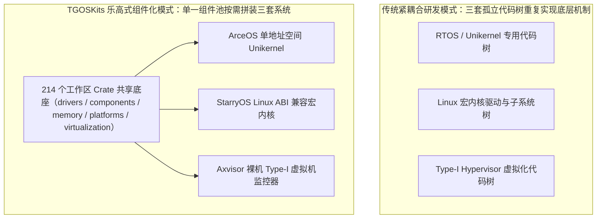
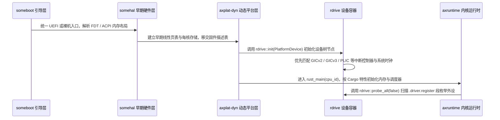
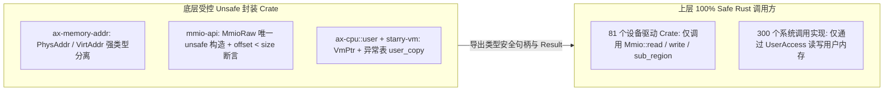
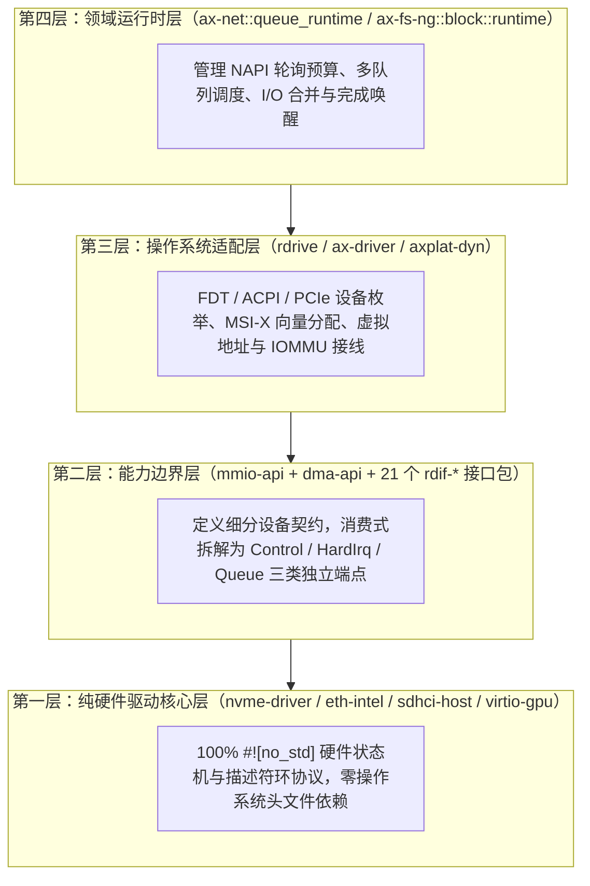
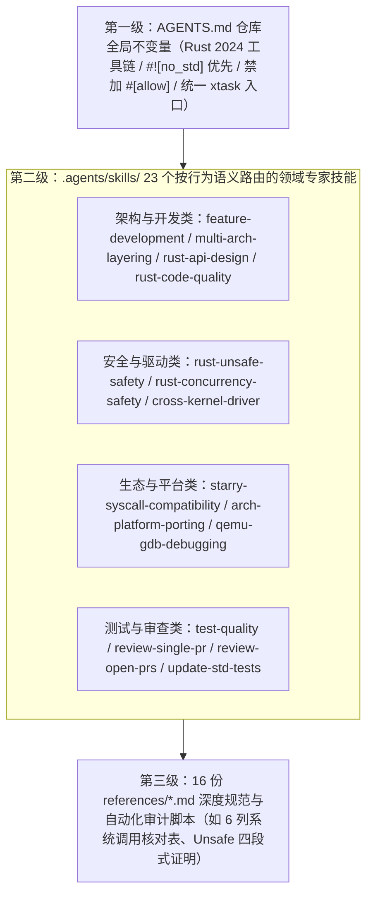

# 内核界的“乐高”：用 Rust 组件按需拼装多形态内核

本报告面向三十分钟技术汇报设计，系统阐述 TGOSKits 开源操作系统组件仓库的架构演进、三套操作系统形态装配、三重软件包级安全边界以及面向智能体辅助研发的工程控制体系。全文包含二十二页幻灯片的展示结构、关键源码锚点、架构图谱与逐页完整演讲词，按每分钟二百六十至三百字的语速规划，总演讲时长为三十分钟。

| 汇报章节 | 对应幻灯片 | 建议时长 | 核心技术议题与源码锚点 |
| --- | --- | --- | --- |
| 第一章：项目定位与架构全景 | 第 1 页至第 3 页 | 4 分钟 | 多内核重复造轮子痛点、214 个成员软件包、四大指令集架构与七层目录矩阵 |
| 第二章：乐高式组件化装配机制 | 第 4 页至第 6 页 | 5 分钟 | `ax-crate-interface` 零成本反向绑定、`arceos_api` 条件装配、`someboot` 与 `rdrive` 动态探测、Git Subtree 混合多仓同步 |
| 第三章：一套底座拼装三套操作系统 | 第 7 页至第 12 页 | 7 分钟 | ArceOS 单地址空间运行时、StarryOS 三百个 Linux 系统调用与 NixOS 自举、Axvisor 裸机虚拟化与 Web 管控面实机演示 |
| 第四章：主流操作系统架构横向对比 | 第 13 页至第 14 页 | 4 分钟 | 对比 Linux、Xen、RTOS 等 C 语言内核，以及 Asterinas、Redox、Theseus、TockOS、Rust-for-Linux 的架构取舍 |
| 第五章：基于软件包的三重安全边界 | 第 15 页至第 18 页 | 6 分钟 | `mmio-api` 与 `dma-api` 裸指针边界、`RawSpinLock` 与 `CpuPin` 并发边界、`rdif-*` 四层跨内核可移植驱动与三端点拆解 |
| 第六章：面向智能体协作的内核工程体系 | 第 19 页至第 22 页 | 4 分钟 | 78 个软件包宿主机秒级单测、`sync_lint` 与运行时死锁检查、23 个领域技能语义路由、`agent-review-bench` 审查基准闭环 |

上表给出了三十分钟汇报的节奏分配。前十六分钟聚焦组件化架构如何支撑三套截然不同的操作系统并展示实机运行画面，后十四分钟深入剖析与其他 Rust 操作系统的差异、三重软件包安全边界以及智能体可控研发闭环。

## 1. 项目定位与架构全景

操作系统研发长期面临专用场景性能与通用软件生态难以兼顾的结构性矛盾。TGOSKits 将传统单体内核拆解为可按需组合的细粒度 Rust 软件包，在单一工作区内同时构建面向极致性能的单地址空间内核、面向丰富应用生态的 Linux 二进制兼容内核，以及面向硬件隔离的裸机虚拟机监控器。

### 1.1 跨内核重复造轮子的工程痛点

对应第 1 页与第 2 页幻灯片（建议用时 2 分钟）。传统系统软件团队在开发嵌入式固件、通用服务器内核与虚拟化管理程序时，往往维护三套彼此割裂的代码树。即便使用相同芯片平台，网卡驱动、页表管理、伙伴内存分配器与多核中断路由也必须在各自内核的内部接口上重写，导致驱动生态碎片化与安全修复滞后。



从上图可以看到，TGOSKits 的核心设计目标是消除跨内核形态的底层重复建设。下段为第 1 页与第 2 页幻灯片的完整演讲词。

> **【第 1 页至第 2 页演讲稿 | 00:00 - 02:00】**
> 各位老师、同事大家好，今天我汇报的题目是《内核界的“乐高”：用 Rust 组件按需拼装多形态内核》，为大家介绍 TGOSKits 项目的架构设计与工程实践。我们先思考一个在操作系统工程里困扰行业几十年的问题：为什么每当应用场景变化，比如从云端高密度的轻量函数计算，切换到需要跑大型数据库与图形桌面的通用系统，再切换到车载和边缘计算需要的硬件虚拟化隔离时，研发团队总是被迫维护三套完全不同的内核代码树？
> 在传统的内核研发模式里，实时操作系统、Linux 宏内核以及像 Xen 这样的裸机 Hypervisor，各自拥有一套私有的内存分配器、锁原语、页表操作和驱动模型。你在 Linux 里写好的 NVMe 驱动或者千兆网卡驱动，搬到 Unikernel 或者 Hypervisor 里几乎要从头重写。这直接造成了底层硬件适配工作成倍浪费，一个并发缺陷或内存越界漏洞往往需要在多套代码库里反复排查。
> TGOSKits 给出的解法是把操作系统彻底组件化。我们用 Rust 2024 工具链构建了一个像乐高积木池一样的系统软件工作区。最底层的物理内存管理、页表引擎、硬件启动协议、跨内核设备驱动和虚拟化组件全部做成独立的 `#![no_std]` 软件包；在此之上，通过特性开关与链接期接口绑定，像拼积木一样自由拼装出三套定位截然不同的操作系统：面向单地址空间低开销运行的 ArceOS、面向完整 Linux 二进制生态的 StarryOS，以及面向多客户机隔离的裸机虚拟机监控器 Axvisor。

### 1.2 四大架构与七层目录矩阵

对应第 3 页幻灯片（建议用时 2 分钟）。TGOSKits 根工作区 `Cargo.toml` 采用 Cargo Resolver v3 统一管理 214 个成员软件包，并在发布构建配置中开启 `lto = "fat"` 全程序链接期优化，使跨软件包抽象在最终机器码层面可以完全内联。整个代码库在纵向上划分为七个职责正交的顶层目录，在横向上统一支持 `AArch64`、`RISC-V 64`、`x86_64` 与 `LoongArch64` 四大指令集架构。

| 顶层目录 | 软件包数量 | 核心代表软件包 | 架构分层职责与边界约束 |
| --- | --- | --- | --- |
| `drivers/` | 81 个 | `rdrive`、`ax-driver`、21 个 `rdif-*`、`nvme-driver`、`virtio-gpu`、`rockchip-npu` | 跨内核可移植 `#![no_std]` 设备驱动与标准化设备接口定义，零操作系统依赖 |
| `components/` | 39 个 | `ax-task`、`axsched`、`axcpu`、`axklib`、`crate_interface`、`percpu`、`cpu-local` | 与具体内核形态无关的调度算法、架构陷入上下文、核本地存储、回溯与链接期接口胶水 |
| `os/` | 23 个 | `ax-runtime`、`arceos_api`、`starry-kernel`、`starry-vm`、`starry-signal`、`axvisor` | 三套操作系统成品组装层、系统调用分发层与虚拟化管控平面 |
| `virtualization/` | 17 个 | `axvm`、`axaddrspace`、`axdevice`、`arm_vgic`、`riscv_vplic`、`x86_vlapic` | 二阶段嵌套页表、虚拟 CPU 生命周期、架构虚拟中断控制器与半虚拟化后端 |
| `memory/` | 8 个 | `ax-memory-addr`、`mmio-api`、`dma-api`、`page-table-generic`、`buddy-slab-allocator` | 强类型物理与虚拟地址、安全寄存器映射、直接内存访问状态机与通用多级页表 |
| `platforms/` | 6 个 | `someboot`、`somehal`、`axplat-dyn`、`ax-plat` | 统一多架构固件引导入口、设备树与高级配置电源接口解析、运行时中断控制器自适应 |
| `fs/` 与 `net/` | 4 个 | `ax-fs-ng`、`axfs-ng-vfs`、`rsext4`、`ax-net` | 多队列块存储运行时、第四代扩展文件系统实现与无锁轮询网络协议栈运行时 |

上表展示了 214 个成员软件包在七大目录中的分布结构。所有位于 `drivers/`、`memory/`、`components/` 和 `virtualization/` 的可复用软件包默认遵守 `#![no_std]` 约束，不允许反向依赖 `os/` 目录下的任何具体内核实现。下段为第 3 页幻灯片的完整演讲词。

> **【第 3 页演讲稿 | 02:00 - 04:00】**
> 来看第 3 页的仓库全景矩阵。目前 TGOSKits 的根 `Cargo.toml` 一共管理着 214 个工作区成员 Crate，所有底层可复用组件严格遵循 `#![no_std]` 规范，并在构建发布镜像时启用 `lto = "fat"` 全程序链接优化。这意味着虽然我们在源码层面把内核切分成了两百多个细粒度的软件包，但编译器在最终生成内核镜像时会跨 Crate 完成内联优化，不会因为模块化拆分带来额外的函数调用开销。
> 在纵向结构上，这 214 个软件包分布在七个正交的领域目录中。最庞大的 `drivers/` 目录包含 81 个软件包，其中包括 21 个以 `rdif-` 开头的设备接口定义包，以及覆盖 NVMe、SDHCI、PCIe、千兆与万兆以太网、Wi-Fi 6、VirtIO-GPU、SMMUv3 乃至 RK3588 NPU、K230 KPU、SG2002 TPU 的硬件驱动；`components/` 目录包含 39 个基础组件，提供多算法调度器、每核变量、中断框架与异常回溯；`memory/` 目录用 8 个高内聚软件包收敛了所有物理地址、MMIO、DMA 与页表操作；`platforms/` 目录用 6 个软件包打通了 UEFI 与设备树动态启动；`virtualization/` 目录用 17 个软件包提供跨四大架构的硬件虚拟化支撑；最上层的 `os/` 目录则用 23 个软件包把这些积木拼成 ArceOS、StarryOS 和 Axvisor。在横向维度上，这一整套软件栈同时支持 AArch64、RISC-V 64、x86_64 和 LoongArch64 四大主流架构。

## 2. 乐高式组件化装配机制

将两百多个软件包组合成不同操作系统，关键在于解决双向依赖解耦、按需裁剪、动态硬件枚举与多仓库协同四个工程问题。TGOSKits 通过链接期符号绑定、编译期特性图谱、运行时固件解析和子树同步脚本构成了完整的组件装配流水线。

### 2.1 零成本链接期反向绑定

对应第 4 页幻灯片（建议用时 2 分钟）。在分层内核中，底层驱动或文件系统经常需要调用上层操作系统提供的内存分配、虚拟地址转换或睡眠等待能力。若使用 Rust 泛型参数逐层传递，会导致数十个类型参数污染整个调用链；若使用动态特征对象 `dyn Trait`，则会引入虚表间接跳转开销并阻碍编译器内联。TGOSKits 在 `components/crate_interface` 与 `components/trait-ffi` 中实现了编译期与链接期结合的零成本反向绑定机制。

```rust
// 1. 底层组件声明所需外部能力契约（components/axklib/src/lib.rs）
#[def_interface]
pub trait Klib {
    fn mem_alloc_pages(num_pages: usize, align_pow2: usize) ->AxResult<VirtAddr>;
    fn mem_phys_to_virt(paddr: PhysAddr) -> VirtAddr;
    fn irq_set_enable(irq: usize, enabled: bool);
    fn time_busy_wait(dur: Duration);
}

// 2. 上层内核或运行时在各自装配包中提供具体实现
struct KlibImpl;
#[impl_interface]
impl Klib for KlibImpl {
    fn mem_phys_to_virt(paddr: PhysAddr) -> VirtAddr {
        ax_hal::mem::phys_to_virt(paddr)
    }
    // ... 其余 17 项底层平台服务实现
}
```

如上述代码所示，宏 `#[def_interface]` 会自动生成带命名前缀的外部符号声明与便捷调用封装函数 `call_interface!`，而上层内核通过 `#[impl_interface]` 在编译期检查签名一致性并导出对应链接符号。在开启 Fat LTO 后，链接器直接将 `axklib::mem::phys_to_virt` 内联为一条偏移加法指令。下段为第 4 页幻灯片的完整演讲词。

> **【第 4 页演讲稿 | 04:00 - 06:00】**
> 很多开发者会问：既然底层驱动和组件不依赖具体的操作系统，那当一个底层驱动需要把物理地址转成虚拟地址、需要申请连续页帧或者需要开启某个中断号时，它怎么调用上层内核的能力？如果用泛型，一个结构体要带上七八个泛型参数，代码根本没法读；如果用 `dyn Trait` 虚表，每次寄存器读写或地址转换都要走一次函数指针间接跳转，在内核热路径上性能损失很大。
> 第 4 页展示了 TGOSKits 的核心粘合机制：`ax-crate-interface` 与 `axklib`。在 `components/crate_interface` 中，我们设计了两个过程宏：`#[def_interface]` 和 `#[impl_interface]`。比如底层公共库 `axklib` 用 `#[def_interface]` 定义了 `Klib` 特征，包含物理转虚拟地址、页分配、中断使能、微秒级延时等 18 个核心钩子函数。底层驱动只需要直接调用 `axklib` 暴露的函数即可，完全不需要知道当前运行在 ArceOS、StarryOS 还是宿主机的测试桩上。
> 到了最终组装操作系统镜像时，上层内核用 `#[impl_interface]` 为 `Klib` 提供实现。过程宏会在编译期生成隐藏的类型守卫函数，强制校核接口参数与返回值类型，并把方法导出为确定性的全局链接符号。一旦在最终构建时开启 `lto = "fat"`，LLVM 链接器在全局优化阶段就能直接把跨 Crate 的接口调用内联展开，既有强类型的编译期契约检查，又实现了零虚表、零泛型传染的机器码效率。

### 2.2 编译期特性裁剪与动态硬件发现

对应第 5 页幻灯片（建议用时 1.5 分钟）。在系统功能裁剪层面，`os/arceos/api/arceos_api/src/macros.rs` 中的 `define_api!` 與 `define_api_type!` 宏将操作系统能力划分为 `alloc`、`paging`、`multitask`、`smp`、`fs`、`net`、`display`、`uspace` 和 `hv` 等正交 Cargo 特性。当某个特性未开启时，`os/arceos/modules/axruntime/src/bootstrap.rs` 中的引导入口 `rust_main` 会彻底省略对应子系统的初始化代码与静态数据结构。在硬件适配层面，TGOSKits 通过 `someboot -> somehal -> axplat-dyn -> rdrive` 四级链路取代了传统嵌入式内核硬编码物理地址的做法。



如上述时序图所示，所有具体硬件驱动通过链接器段 `.driver.register` 静态注册匹配描述符，`rdrive::probe_all(false)` 在运行时遍历设备树或 PCIe 配置空间并自动绑定驱动实例，使同一个内核二进制无需重新编译即可在 QEMU 与多款真实开发板上启动。下段为第 5 页幻灯片的完整演讲词。

> **【第 5 页演讲稿 | 06:00 - 07:30】**
> 解决了跨层调用后，第 5 页展示我们如何在编译期裁剪功能、在运行期动态适配硬件。先看编译期裁剪：`os/arceos/api/arceos_api` 通过 `define_api!` 宏把内核能力拆解为正交的 Cargo Feature 集合。如果你只需要一个在微控制器或极简虚拟机里跑的裸机计算服务，只开 `alloc` 即可，内核连多任务调度器、页表和网络栈都不会编译进去；当需要构建 StarryOS 时开启 `uspace`、`fs` 和 `net`；当需要构建 Axvisor 时开启 `hv` 虚拟化特性。`axruntime` 的 `rust_main` 函数严格按照激活的特性集按序初始化模块，没有用到的模块在最终 ELF 镜像里是零字节。
> 再看运行时的动态硬件发现。早期很多教学型或原型 Rust 内核喜欢把串口地址、内存起始地址写成编译期常量，换一块板子就要改源码重新编译。TGOSKits 通过 `someboot`、`somehal`、`axplat-dyn` 和 `rdrive` 四个组件实现了全动态硬件拉起。`someboot` 统一接管四大架构的 UEFI 或裸机入口，自动从设备树 FDT 或 ACPI 表中提取物理内存分布与内核重定位偏移；随后 `axplat-dyn` 调用 `rdrive` 扫描 `.driver.register` 链接段，自动识别当前板卡是 GICv2 还是 GICv3 中断控制器，并在 `rdrive::probe_all` 阶段按兼容性字符串自动挂载 NVMe、网卡和 GPU 驱动。

### 2.3 单仓开发与多仓同步的混合协作

对应第 6 页幻灯片（建议用时 1.5 分钟）。大型组件化系统在工程管理上往往陷入两难：若采用完全分散的多仓库模式（Polyrepo），修改一个底层驱动接口需要跨十几个仓库先后发版并更新版本号，极易破坏上层内核构建；若采用纯大仓模式（Monorepo），外部社区又难以单独复用其中的某个通用组件（如 `page-table-generic` 或 `sdhci-host`）。TGOSKits 通过 `scripts/repo/repo.py` 与 `scripts/repo/repos.csv` 实现了基于 Git Subtree 的双向同步机制。

| 协作维度 | 纯分散多仓模式 | 纯单体大仓模式 | TGOSKits 混合子树模式 |
| --- | --- | --- | --- |
| 跨层接口重构原子性 | 差，需跨多个仓库分批提交并等待版本发布 | 高，一次提交同时修改底层契约与上层调用点 | 高，在根工作区内一次提交完成全栈重构与测试 |
| 外部社区独立复用能力 | 高，每个组件有独立 Git 仓库与发布流水线 | 差，外部项目被迫克隆整个庞大内核仓库 | 高，`repos.csv` 管理的 42 个子仓库自动双向同步并独立发布 crates.io |
| 版本与依赖漂移治理 | 极易出现同一个驱动接口多版本并存冲突 | 工作区统一版本，但缺乏子模块边界约束 | `[workspace.dependencies]` 集中锁版本，配合 `crates-io-owner` 审计所有权 |

如上表所示，开发者日常在 TGOSKits 根仓库中享受单仓原子提交与全量持续集成验证，而 `python3 scripts/repo/repo.py push_subtrees` 与 `pull_subtrees` 则负责将变动自动映射回 `rcore-os` 与 `arceos-org` 组织下的 42 个独立组件仓库。下段为第 6 页幻灯片的完整演讲词。

> **【第 6 页演讲稿 | 07:30 - 09:00】**
> 第 6 页介绍支撑这套组件化架构日常演进的仓库工程机制。做组件化操作系统最容易踩的工程坑就是仓库拆分方式：如果把两百多个 Crate 拆成几十个完全独立的 Git 仓库，每次调整一个底层 DMA 或块设备 Trait，开发者要连续给十几个仓库提 PR、发 crates.io 版本，研发效率会被版本依赖链拖垮；反过来，如果把所有代码锁死在一个大仓库里，外部开发者想单独用我们的 `page-table-generic` 页表库或者 `rockchip-npu` 驱动就会非常困难。
> TGOSKits 采用的是“Monorepo 原子开发 + Git Subtree 多仓双向同步”的混合架构。我们在根 `Cargo.toml` 的 `[workspace.dependencies]` 中统一锁定所有内部 Crate 与第三方依赖版本，保证任何一次跨驱动、跨内核的接口修改都能在一个 PR 里完成全栈编译和 QEMU 回归测试。同时，通过 `scripts/repo/repos.csv` 配置文件和 `repo.py` 脚本，工作区内的核心组件与 GitHub 上 42 个独立开源子仓库保持双向 Subtree 同步，既保障了大仓全链路验证的确定性，又让每个底层 Crate 都能作为独立的标准 Rust 软件包对外发布和复用。

## 3. 一套底座拼装三套操作系统

依托上述共享组件池，TGOSKits 在 `os/` 目录下装配出三套面向不同场景的操作系统产品：极致轻量的 ArceOS、兼容 Linux 生态的 StarryOS，以及裸机硬件虚拟化的 Axvisor。本章结合各系统的源码结构与真实运行截图说明其具体能力。

### 3.1 ArceOS 单地址空间运行时与实机展示

对应第 7 页与第 8 页幻灯片（建议用时 2 分钟）。ArceOS 是位于 `os/arceos/` 的模块化单地址空间操作系统（Unikernel）与内核底座，包含 17 个内核功能模块、统一接口层 `arceos_api`、POSIX 兼容层 `arceos_posix_api` 以及对标标准库的 `ax-std` 与 `ax-libc`。在 ArceOS 中，应用程序与内核模块运行在同一特权级地址空间内，应用调用 `ax_std::fs::File` 或 `ax_std::net::TcpStream` 时直接编译为对 `ax-fs-ng` 和 `ax-net` 的普通函数调用，彻底消除了用户态与内核态切换、页表切换与系统调用陷入开销。


上图为本次在本地运行 `cargo xtask arceos test qemu --test-group rust --test-case display-basic --arch aarch64` 抓取的真实输出合成图。左侧展示了 `someboot` 在 AArch64 EL1 下完成内存映射、`buddy-slab-allocator` 初始化、`rdrive` 探测 PL011 串口与 `virtio-gpu`、并拉起 4 个 SMP 核心的全过程；右侧展示了应用通过 `embedded-graphics -> ax-display -> rdif-display -> virtio-gpu` 无系统调用直通绘制的 1280x800 帧缓冲画面，整个编译构建加 QEMU 实机运行仅耗时 982 毫秒。下段为第 7 页与第 8 页幻灯片的完整演讲词。

> **【第 7 页至第 8 页演讲稿 | 09:00 - 11:00】**
> 进入第三章，我们看这套乐高组件池拼出的第一套操作系统：ArceOS。ArceOS 位于 `os/arceos/` 目录，它的定位非常清晰：做极致轻量的单地址空间 Unikernel，同时作为上层宏内核与虚拟机监控器的公共运行时底座。
> 在 ArceOS 中，我们提供了与 Rust 标准库 `std` 接口完全对齐的 `ax-std`，以及兼容 C 语言应用接口的 `ax-libc`。当一个 Rust 应用程序把依赖从 `std` 替换为 `ax-std`（或者通过 `ax-libc` 链接现有的 C 程序和 Tokio 异步运行时）时，应用代码和内核组件处于同一个特权级和同一个虚拟地址空间。这意味着一次文件读写、一次网络发包或一次图形帧缓冲刷新，在底层只是一次经过 LTO 内联的普通 Rust 函数调用，没有任何 `svc` 或 `ecall` 系统调用陷入，也没有 TLB 刷新和上下文保存恢复开销。在 `apps/arceos/` 下，我们已经直接运行了裸机 Tokio 异步协程、高性能 HTTP 服务器以及核间共享内存通信应用。
> 第 8 页展示的是我们在本地刚刚实机运行 `display-basic` 用例抓取的画面。左侧终端日志清楚展示了 AArch64 四核启动链路：从 `someboot` 识别设备树随机数种子，到 `buddy-slab-allocator` 完成内存池初始化，再到 `rdrive` 自动枚举出 `virtio-gpu` 并拉起全部 4 个 CPU 核心；右侧则是 QEMU `virtio-gpu-pci` 输出的 1280x800 图形画面，整个四核启动加图形渲染测试在不到 1 秒内全部完成。

### 3.2 StarryOS 宏内核兼容层与生态展示

对应第 9 页与第 10 页幻灯片（建议用时 2.5 分钟）。当应用场景需要运行未经修改的 Linux 原生二进制程序与多进程隔离环境时，TGOSKits 在 ArceOS 底座之上叠加 `os/StarryOS/kernel`（`starry-kernel`）、`os/StarryOS/signal`（`starry-signal`）和 `os/StarryOS/vm`（`starry-vm`），拼装出 Linux ABI 兼容宏内核 StarryOS。在 `os/StarryOS/kernel/src/syscall/` 目录下，系统按架构异常向量捕获用户态系统调用，并通过 13 个领域模块分发实现了 300 个 Linux 系统调用分支，涵盖进程克隆与线程组管理、基于 `PidReservation`（强制保留 `INIT_PID = 1`）的命名空间隔离、`futex` 快速用户态互斥锁、`epoll` 与 `io_uring` 异步 I/O、完整的 `/proc`、`/sys`、`/dev` 伪文件系统，以及 `ebpf`、`kprobe`、`perf` 和可加载内核模块 `kmod` 子系统。


上图展示了 StarryOS 通过 `virtio-gpu` 的 VirGL 三维渲染通道运行 Weston Wayland 合成器与 `glmark2` 三维纹理立方体的实机画面。除桌面图形外，StarryOS 在真实边缘计算板卡上同样具备完整的异构计算驱动能力。


上图展示了 StarryOS 在瑞芯微 RK3588（OrangePi 5 Plus）开发板上通过 `crab-usb` 驱动读取 UVC 摄像头视频流，并调用 `rockchip-npu` 驱动在 NPU 硬件上实时执行 YOLOv8 目标检测的运行结果。在 `apps/starry/` 目录下，StarryOS 已验证 77 类复杂 Linux 应用场景，包括完整的 NixOS Stage-2（成功拉起 `systemd` 并到达 `multi-user.target`）、AArch64 环境下的内核自举编译（`macos-selfbuild`）、PostgreSQL、MariaDB、Redis、Nginx、Firefox 浏览器、`llama-cpp` 大模型推理以及 `codex-cli`、`claw-code` 等编程智能体。下段为第 9 页与第 10 页幻灯片的完整演讲词。

> **【第 9 页至第 10 页演讲稿 | 11:00 - 13:30】**
> 如果说 ArceOS 追求的是单任务极致性能，那么第二套操作系统 StarryOS 解决的就是通用生态问题：如何不改一行用户态源码，直接运行海量的 Linux 现有软件？
> 第 9 页展示了 StarryOS 的拼装方式。StarryOS 并没有重新写一套调度器、物理内存分配器或块设备驱动，而是直接复用了 ArceOS 的全部底层模块，在上方新增了三个核心 Crate：管理多进程虚拟地址空间与缺页异常的 `starry-vm`、处理 POSIX 信号队列与投递帧的 `starry-signal`，以及实现 Linux 内核语义的 `starry-kernel`。在 `os/StarryOS/kernel/src/syscall/` 下，我们按文件系统、内存、网络、进程、同步、信号和时间等 13 个模块实现了 300 个 Linux 系统调用分支，不仅支持标准的 `epoll`、`futex`、Cgroups、Namespace 与伪文件系统，还支持 `io_uring` 异步环形队列、`ebpf`、`kprobe` 与内核模块动态加载。
> 这种高完成度的 Linux ABI 兼容带来了非常扎实的实际运行效果。在系统级里程碑上，StarryOS 已经能够完整跑通 NixOS Stage-2 启动流程，把原生的 `systemd` 作为 1 号进程拉起并直达 `multi-user.target` 多用户登录态；在 AArch64 架构下，StarryOS 还能直接运行 `rustc` 和 `cargo` 完成 StarryOS 自身的内核自举编译。
> 第 10 页展示了两张代表性实机运行截图：左边是在 StarryOS 上运行 Wayland 图形桌面并开启 VirGL 3D 硬件加速渲染 `glmark2` 旋转木箱；右边是在 OrangePi 5 Plus（RK3588 芯片）开发板上，StarryOS 通过自研的 Rust USB 协议栈驱动 UVC 摄像头，并直接驱动瑞芯微 RKNPU 硬件加速卡运行 YOLOv8 实时识别出画面中的苹果和网球。目前 `apps/starry/` 下已经适配了 77 个真实应用，涵盖数据库、Web 网关、浏览器乃至本地大模型推理。

### 3.3 Axvisor 裸机虚拟机监控器与管控面展示

对应第 11 页与第 12 页幻灯片（建议用时 2.5 分钟）。当场景转向云边虚拟化、车载混合关键度系统（在一个物理芯片上同时隔离运行实时控制 RTOS 与富功能 Linux）时，TGOSKits 通过 `os/axvisor` 结合 `virtualization/` 目录下的 17 个组件拼装出裸机 Type-I 虚拟机监控器 Axvisor。Axvisor 巧妙复用了 ArceOS 的多核调度器，将每个客户机虚拟处理器（`vCPU`）封装为一个可调度的 `ax-task` 任务，在 ARM64 EL2、RISC-V H 扩展、x86_64 VMX/SVM 和 LoongArch64 LVZ 硬件虚拟化扩展上统一管理二阶段页表（`axaddrspace`）与虚拟中断注入（`arm_vgic`、`riscv_vplic`、`x86_vlapic`），目前已支持 15 种硬件板卡配置与 62 套客户机配置（可同时引导 Linux、StarryOS、ArceOS、FreeRTOS、RT-Thread 与 Zephyr）。


上图与下图为本次在 QEMU AArch64（EL2 虚拟化开启）中实机启动 Axvisor 并通过浏览器访问其内置 Web 管控面抓取的高清截图。Axvisor 在 `os/axvisor/src/control/` 中内置了基于 `axum`（运行于裸机 `ax-std` 网络栈之上）与前端 React 18、TypeScript、Tailwind CSS、xterm.js 的全功能管控平面，前后端契约由单一能力声明表 `os/axvisor/src/control/capability/table.rs` 通过 `GET /api/manifest` 动态驱动。


从上述两张实机截图中可以看到，宿主机 Axvisor 版本为 `0.8.2`（双核 AArch64），客户机 `VM[1] linux-web-ui` 已完成 31,864 次客户机陷入切入（`guest_entry_count`），其 `vCPU 0` 绑定在物理 `Core 1 (0x2)` 上运行；在第二张图的浏览器 `xterm.js` 控制台中，我们通过 `/ws/vm-1` WebSocket 通道直接在客户机 Linux 7.1.0-rc2 Shell 中执行了 `uname -a` 与算术验证命令。下段为第 11 页与第 12 页幻灯片的完整演讲词。

> **【第 11 页至第 12 页演讲稿 | 13:30 - 16:00】**
> 第三套拼装出来的操作系统是位于 `os/axvisor` 的裸机 Type-I Hypervisor：Axvisor。为什么在有了 ArceOS 和 StarryOS 之后还要做 Axvisor？因为在智能汽车座舱、工业边缘控制器和云计算底座中，用户经常需要在一块多核 SoC 上同时跑一个毫秒级响应的实时系统和一个跑业务容器的 Linux 系统，两者之间必须有硬件级的内存、设备与中断隔离。
> 第 11 页展示了 Axvisor 是如何最大化复用 TGOSKits 组件池的。Axvisor 底下依然跑在 `ax-runtime` 和 `axplat-dyn` 之上，它把每个客户机的 `vCPU` 包装成 `ax-task` 调度器里的一个任务，再用 `virtualization/` 目录下的 `axvm`、`axaddrspace`（负责管理二阶段嵌套页表 Stage-2 Page Table）以及 `arm_vgic`、`riscv_vplic`、`x86_vlapic` 等虚拟中断控制器组件，实现了横跨 ARM64、RISC-V、x86_64 和龙芯四大架构的 Type-I 虚拟机监控器。不仅如此，Axvisor 还引入了基于能力的设备运行时模型（`DeviceRuntime` 与 `DeviceBundle`），只有持有合法 `DmaGrant` 授权令牌的直通设备或半虚拟化设备才能建立客户机物理地址映射。
> 更直观的是第 12 页的实机运行截图。我们在裸机 Hypervisor 内部直接利用 `ax-std` 和 `ax-net` 协议栈跑起了一个异步 `axum` Web 服务器，并嵌入了用 React 18、Tailwind CSS 和 `xterm.js` 构建的现代化 Web 管控台。大家看到的这两张图，就是我们刚刚在本地启动 AArch64 Axvisor、拉起内置的 Linux 7.1 客户机后截下的真实界面：上方截图展示了客户机实时状态、内存分配、31864 次 VM-Entry 计数以及 vCPU 到物理 CPU 核的亲和性矩阵；下方截图展示了直接在浏览器里通过 `/ws/vm-1` WebSocket 连接到客户机串口终端，实时输入 `uname -a` 和 Shell 命令的交互效果。而且整个管控面的 REST API、CLI 命令和前端按钮全部由 `capability/table.rs` 一张静态能力表统一生成，彻底杜绝了前后端接口脱节。

## 4. 主流操作系统架构横向对比

为了明确 TGOSKits 在操作系统谱系中的技术坐标，需要从纵向复用粒度与横向系统形态两个维度，将其与传统 C 语言操作系统及国内外主流 Rust 操作系统项目进行严谨对比。

### 4.1 相比传统 C 语言内核的代际差异

对应第 13 页幻灯片（建议用时 2 分钟）。以 Linux 宏内核、Xen/KVM 虚拟化系统以及 FreeRTOS/RT-Thread 为代表的传统 C 语言系统，在各自单一领域历经长期验证，但其底层普遍受制于 C 语言的隐式内存与并发契约。指针越界、释放后使用（UAF）、未加锁共享字段访问以及中断上下文非法睡眠，在 C 语言编译器层面无法拦截；同时，各系统内部的子系统高度内聚，无法将 Linux 的驱动直接静态编译进 FreeRTOS 或 Xen。

| 对比维度 | Linux 宏内核 | Xen / KVM 虚拟化 | FreeRTOS / RT-Thread | TGOSKits 组件化体系 |
| --- | --- | --- | --- | --- |
| 内存与并发安全保障 | 依赖人工审查与运行期 KASAN，C 指针与锁无编译期强约束 | 裸机 C 代码或依赖宿主 Linux，存在裸指针与设备模拟内存风险 | 无内存隔离或弱隔离，全局状态直接读写 | Rust 所有权借用检查 + `#![no_std]` 强类型能力边界，将 UAF 与锁逃逸拦截在编译期 |
| 跨形态代码复用率 | 低，驱动与子系统深度绑定 `struct device` 与内核全局符号 | 低，Xen 维护独立驱动栈，KVM 必须寄生于完整 Linux 内核 | 低，专用小型驱动框架，无法向上扩展为宏内核或 Hypervisor | 极高，同一套 `drivers/`、`memory/`、`platforms/` 同时支撑 Unikernel、Linux 宏内核与 Type-I Hypervisor |
| 裁剪粒度与最小体积 | 粗，即使 `tinyconfig` 仍保留完整系统调用与虚拟文件系统骨架 | KVM 需携带完整 Linux 宿主，Xen 控制域 Dom0 笨重 | 极小，但不具备 POSIX 多进程、复杂网络与虚拟化扩展能力 | 按 Cargo Feature 从百 KB 级裸机 Unikernel 平滑扩展至完整 NixOS 宏内核与自带 Web 管控的 Hypervisor |

上表表明，TGOSKits 并不是简单地“用 Rust 重写某一个 C 内核”，而是重构了系统软件的供给方式：用一套经过编译器验证的组件库覆盖原先需要三套 C 代码树才能覆盖的场景。下段为第 13 页幻灯片的完整演讲词。

> **【第 13 页演讲稿 | 16:00 - 18:00】**
> 看完了三套系统的实际表现，我们在第四章深入回答一个关键问题：TGOSKits 和现有的主流操作系统、尤其是其他知名的 Rust 操作系统到底有什么本质区别？
> 第 13 页首先对比传统的 C 语言操作系统，包括 Linux 宏内核、Xen/KVM 虚拟化以及 FreeRTOS、RT-Thread 等实时操作系统。传统 C 内核最大的两个痛点，第一是安全性依赖“人肉编码规范”：比如某个结构体字段需要持哪把锁才能访问、哪段内存正在被 DMA 控制器异步读写、哪个函数在关中断上下文里绝对不能睡眠，C 编译器对此一无所知，一旦写错就是线上偶发的内核崩溃或安全漏洞。第二是架构形态锁死：Linux 的驱动强耦合在复杂的 `struct device` 和内核全局变量上，你不可能把 Linux 里的 NVMe 驱动直接拿出来编进 FreeRTOS 或者裸机 Hypervisor。
> 而 TGOSKits 在这两个维度上实现了代际跨越：一方面通过 Rust 的类型系统与所有权机制，把地址合法性、DMA 生命周期和锁上下文全部变成编译期检查；另一方面通过跨内核接口层，让同一份驱动和内存管理代码零修改地复用于微秒级响应的 Unikernel、全功能的 Linux 兼容内核以及裸机 Hypervisor。

### 4.2 相比其他 Rust 操作系统的架构差异

对应第 14 页幻灯片（建议用时 2 分钟）。近年来国内外涌现出多个优秀的 Rust 操作系统项目，但各项目在架构范式上做出了截然不同的取舍：Asterinas（星绽）提出框内核（Framekernel）架构，通过 `ostd` 将 `unsafe` 限制在小型安全框架内，专注于构建 Linux 兼容内核；Redox 采用微内核（Microkernel）设计，将驱动与文件系统置于用户态并通过自定义 `scheme` URL 协议通信；Theseus 探索单地址空间内基于编译器状态的动态热替换（Intralingual OS）；TockOS 专为 32 位微控制器设计胶囊（Capsule）隔离模型；Rust-for-Linux 则在既有 C 语言 Linux 内核树中引入 Rust 绑定层。

| 项目名称 | 核心架构范式 | 目标系统形态 | 支持指令集架构 | Linux 二进制兼容度 | 驱动跨内核可移植性 |
| --- | --- | --- | --- | --- | --- |
| **TGOSKits** | **纵向分层解耦 + 横向三态拼装** | **Unikernel + Linux 宏内核 + Type-I Hypervisor** | **AArch64 / RISC-V64 / x86_64 / LoongArch64** | **高（300 个系统调用，跑通 NixOS `systemd` 与自举编译）** | **高（`rdif-*` + `mmio-api` + `dma-api`，零 OS 耦合）** |
| **Asterinas（星绽）** | 框内核（Framekernel，`ostd` 隔离 TCB） | 单一 Linux 兼容内核 | x86_64 / RISC-V64（推进中） | 高（专注 Linux 系统调用兼容） | 低，驱动构建于专属 `ostd` 框架之上 |
| **Redox OS** | 纯微内核（用户态驱动与 IPC 通信） | 独立生态桌面与服务器系统 | x86_64 / AArch64 / RISC-V | 依赖用户态 `relibc` 源码重编译，非原生 Linux ABI | 中，驱动绑定 Redox `scheme` 进程间通信模型 |
| **Theseus OS** | 单地址空间语言级操作系统（SASOS） | 研究型高可用运行时 | x86_64 / AArch64（实验性） | 无原生 Linux 二进制兼容 | 低，深度依赖专属 `Cell` 加载与状态迁移框架 |
| **TockOS** | 嵌入式授权胶囊内核（Grant + Capsule） | 32 位物联网微控制器固件 | ARM Cortex-M / RISC-V 32 | 无（面向传感器与低功耗 MCU） | 低，专用于无 MMU 的异步事件驱动模型 |
| **Rust-for-Linux** | C 宏内核内部双语言混合绑定 | Linux 内核模块与子系统 | 同 Linux 主线 | 原生 Linux 内核 | 无，Rust 代码必须适配 C 侧 `struct device` 生命周期 |

上表清晰揭示了 TGOSKits 在 Rust OS 领域中的独特位置：其他项目大多聚焦于单一内核范式（只做 Linux 替代、只做微内核、只做 MCU 或只做 C 内核插件），而 TGOSKits 通过将安全边界下沉到独立的领域 Crate（而非绑定在某个单一内核框架上），成为目前唯一能够从同一套组件库同时衍生出 Unikernel、Linux 兼容宏内核和裸机 Type-I Hypervisor，并全面贯通四大指令集架构的开源系统软件基座。下段为第 14 页幻灯片的完整演讲词。

> **【第 14 页演讲稿 | 18:00 - 20:00】**
> 第 14 页我们进一步对比当前社区里最受关注的五个 Rust 操作系统项目：Asterinas（星绽）、Redox、Theseus、TockOS 和 Rust-for-Linux。
> 先看 Asterinas 星绽，它提出了非常优秀的“框内核（Framekernel）”理念，用 `ostd` 框架把 `unsafe` 操作圈起来，向上用 Safe Rust 写内核服务。但星绽的定位是专注于做一个 Linux 兼容内核，它的驱动和服务都直接构建在 `ostd` 之上，不能拆出来单独拼装成几十 KB 的 Unikernel，也没有覆盖裸机 Type-I Hypervisor 场景。
> 再看 Redox OS，它走的是经典微内核路线，把文件系统和驱动都放到用户态进程，通过自定义的 `scheme` 接口做 IPC 通信。这种设计隔离性好，但每次 I/O 都要跨地址空间通信，而且它采用自研的系统接口，跑 Linux 软件需要通过 `relibc` 重新编译，无法像 StarryOS 这样直接把未修改的 NixOS 二进制和 `systemd` 跑起来。
> 至于 Theseus 侧重于单地址空间的编译期状态热替换研究，TockOS 专注于没有 MMU 的 32 位 Cortex-M 微控制器，而 Rust-for-Linux 则是给庞大的 C 语言 Linux 内核写安全的胶水绑定，依然受制于 C 侧复杂的对象生命周期。
> 总结起来，TGOSKits 与它们最大的区别可以用十二个字概括：“纵向分层解耦，横向三态拼装”。我们没有把安全边界绑死在某一个特定的内核形态上，而是把内存安全、并发安全、驱动接口做成了与操作系统形态无关的独立 Crate，从而同时实现了 Unikernel 的高性能、StarryOS 的原生 Linux 二进制兼容、Axvisor 的裸机虚拟化，以及横跨 ARM64、RISC-V、x86_64 和龙芯四大架构的统一硬件生态。

## 5. 基于软件包的三重安全边界

操作系统内核无可避免要与裸指针、硬件寄存器、直接内存访问控制器、多核锁以及外部中断交互。TGOSKits 的核心设计原则是：不依赖全工作区范围的君子协定，而是以 Crate（软件包）为最小防线，将 `unsafe` 硬件操作、并发锁语义与外设驱动隔离在受控边界之内。

### 5.1 硬件内存与裸指针边界

对应第 15 页幻灯片（建议用时 1.5 分钟）。在传统内核中，物理地址与虚拟地址常以无差别的整型 `usize` 或 `u64` 传递，极易发生将物理地址直接解引用、或寄存器偏移越界读写等致命错误。TGOSKits 在 `memory/memory_addr`、`memory/mmio-api` 和 `os/StarryOS/vm` 中建立了第一道基于软件包的硬件内存边界。



如上图所示，`ax-memory-addr` 将 `PhysAddr` 与 `VirtAddr` 封装为独立的透明结构体，仅有 `VirtAddr` 提供转换为裸指针的接口，从源头杜绝物理地址解引用。在寄存器访问上，`memory/mmio-api/src/lib.rs` 规定 `MmioRaw::new` 是唯一的 `unsafe` 入口，驱动持有的 `Mmio` 句柄在每次调用 `read<T>(offset)`、`write<T>(offset, val)` 或 `sub_region(offset, len)` 时都会执行 `assert!(offset < self.size)` 边界检查与对齐检查，并在 `Drop` 时自动调用 `MmioOp::iounmap` 释放映射。在用户态内存访问上，`starry-vm` 的 `VmPtr<T>` 强制要求目标类型满足 `bytemuck::AnyBitPattern`（禁止从用户空间读取含非法枚举判别式或裸引用的结构），并配合 `components/axcpu/src/user_access.rs` 的硬件异常表（Exception Table）将缺页或非法地址访问安全转化为 `AxResult`，同时用 `UserAccess<Faultable>` 与 `UserAccess<NoFault>` 在编译期区分可睡眠路径与持自旋锁路径。下段为第 15 页幻灯片的完整演讲词。

> **【第 15 页演讲稿 | 20:00 - 21:30】**
> 第五章我们深入代码细节，看看 TGOSKits 是如何用 Crate 来划分三重安全边界的：第一重是 `unsafe` 与硬件内存边界，第二重是锁与并发边界，第三重是驱动边界。
> 先看第 15 页的硬件内存边界。在内核里，最危险的 `unsafe` 操作集中在四件事：地址转换、MMIO 寄存器读写、DMA 内存共享和用户态指针拷贝。TGOSKits 的做法是把这四件事分别关进四个专门的底层 Crate 里，让上层业务代码和驱动代码不用写裸指针。
> 首先，`ax-memory-addr` 把物理地址 `PhysAddr` 和虚拟地址 `VirtAddr` 定义成两个完全独立的新类型，只有 `VirtAddr` 才能转成指针，物理地址在语法上根本无法解引用。其次，在 `mmio-api` 软件包中，只有平台层构造映射时的 `MmioRaw::new` 是 `unsafe` 函数；一旦生成了 `Mmio` 句柄交给设备驱动，驱动调用的 `read`、`write` 和划分子区域的 `sub_region` 全部是 Safe 函数，内部自动完成 `offset < self.size` 越界断言、对齐校验和 `volatile` 语义，并在句柄析构时通过 RAII 自动解除映射。第三，在 StarryOS 访问用户态内存时，`starry-vm` 强制要求传输结构体实现 `bytemuck::AnyBitPattern`，防止用户态传入非法的布尔值或枚举判别式触发 Rust 未定义行为，并通过 `ax-cpu` 的硬件异常表把任何非法用户指针访问捕获为普通的 `Err`，绝不因为用户态传入野指针而导致内核崩溃。

### 5.2 直接内存访问类型状态机与页表回收契约

对应第 16 页幻灯片（建议用时 1.5 分钟）。直接内存访问（DMA）与多核页表映射卸载是内核中最隐蔽的两类释放后使用（UAF）漏洞来源：如果驱动在网卡或 NVMe 控制器尚未结束 DMA 传输时就提前释放了缓冲区，外设就会向已被分配给其他内核对象的物理内存中写入脏数据；如果一个 CPU 修改了页表并立即释放物理页帧，而其他 CPU 的快表（TLB）仍缓存着旧映射，就会造成跨核内存篡改。TGOSKits 在 `memory/dma-api` 与 `memory/page-table-generic` 中利用线性类型状态机根除了这两类隐患。

```mermaid
stateDiagram-v2
    [*] --> CpuDmaBuffer: DeviceDma::alloc_coherent / alloc_streaming
    CpuDmaBuffer --> PreparedDma: prepare_read / prepare_write（刷 Cache 并校验 DmaConstraints）
    PreparedDma --> InFlightDma: submit（移交外设，启用 ManuallyDrop 保护）
    InFlightDma --> CompletedDma: complete（硬件正常完成，同步 Cache 并恢复 CPU 访问）
    InFlightDma --> QuarantinedDma: abort_and_quarantine 或未完成即 Drop（隔离物理页，禁止归还分配器）
    CompletedDma --> CpuDmaBuffer: into_buffer（安全复用或正常释放）
```

如上述状态机所示，`memory/dma-api/src/owned.rs` 将 DMA 缓冲区生命周期编码为四个不可跳过的类型状态。当缓冲区进入 `InFlightDma` 状态后，其内部物理内存由 `ManuallyDrop` 托管；如果驱动因超时或错误提前丢弃 `InFlightDma`，代码不会将物理页帧归还给伙伴分配器，而是强制转入 `QuarantinedDma` 隔离状态，从根本上消除了硬件悬空写入。同样，`memory/page-table-generic/src/table.rs` 在执行 `unmap_region` 时不会直接释放页表帧，而是返回带有 `#[must_use]` 标记的 `DeferredPageTableFrames<A>` 令牌；调用方唯有完成跨核 TLB 刷新后调用 `unsafe fn reclaim(self)` 才能回收物理帧，若中途直接丢弃令牌，析构函数会发出告警并安全泄漏该页帧以保全系统内存安全。下段为第 16 页幻灯片的完整演讲词。

> **【第 16 页演讲稿 | 21:30 - 23:00】**
> 第 16 页展示我们在 `dma-api` 和 `page-table-generic` 两个软件包中设计的两套硬件级防呆机制。写过底层驱动的同学都知道，DMA 最大的噩梦是超时错误处理：当一次 NVMe 或网卡传输超时，驱动如果直接 `drop` 掉缓冲区把物理页还给内存分配器，而此时失控的硬件控制器还在往这个物理地址做 DMA 写操作，就会静默踩坏其他内核模块的数据，这种 Bug 往往几个星期都查不出来。
> 在 `memory/dma-api` 中，首先我们通过 `DeviceDma` 校验设备的地址掩码 `addr_mask`、对齐和 IOMMU 转换域，并要求传输结构实现 `DmaPod` 特征；更关键的是，我们在 `owned.rs` 里把 DMA 缓冲区做成了一个编译期类型状态机：`CpuDmaBuffer` 经过缓存同步变成 `PreparedDma`，提交给硬件后消费自身变成 `InFlightDma`。处于 `InFlightDma` 状态时，CPU 在编译期拿不到任何读写引用的方法，而且内部用 `ManuallyDrop` 锁死了物理内存。如果硬件正常完成，调用 `complete()` 回到 `CompletedDma`；如果驱动在硬件未确认停止前异常退出或丢弃了 `InFlightDma`，析构逻辑会自动把这块物理内存打入 `QuarantinedDma` 隔离区，宁可隔离这几个物理页，也绝不把仍在被硬件异步读写的内存还给全局分配器，从根源上消灭了 DMA Use-After-Free。
> 同样的思路也用在了通用页表库 `page-table-generic` 上。整个页表库不含一行架构条件编译代码，当卸载一段地址映射时，它不会立刻释放页表物理帧，而是返回一个 `#[must_use]` 的 `DeferredPageTableFrames` 延迟回收令牌。上层内存管理模块必须先发 IPI 完成多核 TLB 击落（TLB Shootdown），然后显式调用 `reclaim()` 才能回收物理页；如果忘了刷新就直接丢弃，系统会安全保留该页帧并打印告警，绝不让旧 TLB 指向被复用的内存。

### 5.3 显式锁语义与所有权转移并发边界

对应第 17 页幻灯片（建议用时 1.5 分钟）。在多核与中断并发场景下，TGOSKits 彻底移除了标准无感知的 `spin` 裸自旋锁依赖，通过 `os/arceos/modules/axsync`、`components/ax-task`、`components/cpu-local` 和 `components/percpu` 建立了第二道并发与锁边界。所有同步原语遵循三条铁律：第一，自旋锁调用点必须显式声明执行上下文；第二，每核数据访问必须持有不可逃逸的编译期生命周期令牌；第三，I/O 高频路径优先用单核所有权转移替代共享锁。

| 并发机制与所属软件包 | 核心类型与函数锚点 | 编译期与运行期安全保障机制 |
| --- | --- | --- |
| 上下文显式自旋锁（`ax-task::sync` / `ax-sync`） | `RawSpinLock::lock()`、`lock_irqsave()`、`SpinGuard (!Send)` | 区分仅关抢占的任务态锁与关本地中断的 IRQ 锁；守卫标记 `PhantomData<*mut ()>` 禁止跨任务或跨 `.await` 发送 |
| 优先级继承睡眠互斥锁（`ax-sync`） | `Mutex::lock()`、内置 `might_sleep()` 检查 | 纯正阻塞睡眠锁，绝不静默退化为自旋锁；在关中断或持自旋锁上下文中调用立即触发确定性断言 |
| 高阶生命周期每核证明（`cpu-local` / `ax-percpu`） | `with_cpu_pin(op: impl for<'scope> FnOnce(&CpuPin<'scope>))` | 利用 HRTB 高阶生命周期将每核可变借用鎖定在关抢占闭包内，编译期阻止每核引用逃逸到核切换之后 |
| 无锁单核所有权轮询组（`ax-net` / `rdif-eth`） | `NetPollGroupParts`、`owner_cpu`、4 条 SPSC 环形队列 | 强制硬中断 CPU、队列处理 CPU 与轮询组 `owner_cpu` 三者合一，通过 `rx_ready` / `tx_ready` 无锁转移 `DmaBuffer` 令牌 |
| 双重静态与动态并发门禁（`axbuild` / `ax-task`） | `cargo xtask sync-lint`、`lockdep`（1024 类锁图谱） | AST 静态拦截 3 类 `Ordering::Relaxed` 同步误用；运行期 `HeldLockStack` 实时捕获递归死锁、ABBA 死锁与锁序反转 |

上表总结了 TGOSKits 的并发防护矩阵。例如在 `memory/buddy-slab-allocator` 中，分配器通过 `CpuPin` 在当前核无锁操作本地 Slab 缓存，跨核释放则推入无锁原子链表；在网络栈 `ax-net` 中，每个硬件收发队列对由唯一 `owner_cpu` 独占轮询，消除了多核争抢同一网卡队列的自旋锁开销。下段为第 17 页幻灯片的完整演讲词。

> **【第 17 页演讲稿 | 23:00 - 24:30】**
> 第 17 页介绍第二道防线：锁与并发边界。很多早期 Rust 内核直接引用社区的 `spin::Mutex`，这种裸自旋锁既不关内核抢占，也不关本地中断，如果一个任务刚拿到锁就被时钟中断打断，或者中断处理函数本身也要拿同一把锁，当前 CPU 就会瞬间死锁。
> 在 TGOSKits 中，我们把锁边界严格收敛在 `ax-sync` 和 `ax-task::sync` 软件包内。首先，我们用 `RawSpinLock` 强制调用者在写代码时做出显式选择：如果数据只在普通任务之间共享，调用自动关抢占的 `lock()`；如果数据会被中断处理程序访问，必须调用自动保存并关闭本地中断的 `lock_irqsave()`。同时，所有锁守卫都通过 `PhantomData<*mut ()>` 标记为 `!Send`，编译器直接在语法层面禁止把自旋锁守卫跨线程转移或带入异步等待点。而 `ax_sync::Mutex` 则是纯粹的、带优先级继承的可睡眠互斥锁，入口处直接调用 `might_sleep()`，一旦有人在关中断或持自旋锁期间误调睡眠锁，运行时立刻精准报错。
> 更高明的设计是“用所有权转移消灭锁”。在 `cpu-local` 组件中，我们利用 Rust 的高阶生命周期（`for<'scope> FnOnce(&CpuPin<'scope>)`）构造了每核固定令牌 `CpuPin`，编译器能静态证明你拿到的每核变量引用绝不可能逃逸出关抢占的作用域。而在 `ax-net` 网络栈和 `ax-fs-ng` 块存储层，我们干脆去掉了硬件队列上的多核共享锁：每个网络轮询组绑定唯一的 `owner_cpu`，硬中断、NAPI 轮询和队列收发固定在同一个核心上执行，并利用 4 条无锁单生产者单消费者（SPSC）环形队列与协议栈传递 `DmaBuffer` 所有权令牌，既没有锁竞争，又消除了死锁风险。

### 5.4 跨内核四层可移植驱动与三端点拆解边界

对应第 18 页幻灯片（建议用时 1.5 分钟）。为了让 `drivers/` 目录下的 81 个驱动软件包既能跑在单地址空间 ArceOS 上，又能跑在多进程 StarryOS 和虚拟化 Axvisor 上，TGOSKits 建立了四层驱动架构，并强制推行“控制、硬中断、队列”三端点消费式拆解（Consuming Split）与“中断只同步状态，任务才推进流程”的执行模型。



如上图所示，第二层由 21 个细粒度 `rdif-*` 软件包（如 `rdif-eth`、`rdif-block`、`rdif-serial`、`rdif-intc`）组成，拒绝使用大一统的胖内核接口。当设备完成初始化后，通过调用 `NetDevice::into_parts(self)`、`BlockController::advance()` 或 `SplitUart::split(self)` 将原来的单一设备对象消费掉（Consume `self`），拆解为三个所有权相互独立的端点：`Control` 控制端点处理低频配置，`Queue` 队列端点交由绑核工作任务独占推进收发环，而满足 `Send + !Sync` 的 `HardIrq` 端点则直接移入操作系统中断闭包。在硬中断触发时，`HardIrq` 仅读取并清除读清型（Read-to-Clear）状态寄存器、屏蔽本队列中断并返回轻量级值快照（如 `IrqAck` 或 `NetHardIrqResult::Schedule`），绝不在中断上下文内争抢队列锁、分配内存或遍历描述符环；随后的重负载收发由工作任务在预算内完成后调用 `rearm_and_check()` 闭合竞态窗口。下段为第 18 页幻灯片的完整演讲词。

> **【第 18 页演讲稿 | 24:30 - 26:00】**
> 第 18 页展示我们的第三道防线：跨内核四层驱动边界。为什么传统驱动代码最容易写乱？因为一个驱动类里往往同时塞进了 PCIe 探测、寄存器读写、DMA 分配、中断处理函数和协议栈回调，硬中断和下半部工作线程同时去抢同一个设备结构体里的锁。
> TGOSKits 把驱动严格切分为四层：最底下第一层是纯硬件驱动核心层（比如 `nvme-driver`、`eth-intel`、`sdhci-host`），它们只实现硬件手册规定的状态机和描述符环格式，不包含任何操作系统的概念；第二层是能力边界层，由 `mmio-api`、`dma-api` 和 21 个细粒度的 `rdif-*` 接口包组成，需要什么硬件能力就传入什么对象，绝不搞一个无所不包的全局 `KernelHal`；第三层是 `rdrive` 和 `ax-driver` 组成的 OS 适配层，负责设备树枚举和中断接线；第四层则是网络和块设备的领域运行时。
> 在这套架构里最核心的创新是“三端点消费式拆解”。以网卡接口 `rdif-eth` 的 `NetDevice::into_parts(self)` 和串口 `SplitUart::split(self)` 为例，设备初始化完成后，`self` 会被直接消费掉，拆成三个物理上独立的 Rust 对象：`Control` 端点、`Queue` 队列端点和 `HardIrq` 硬中断端点。其中 `HardIrq` 端点被移动（Move）进中断注册闭包里，由中断上下文独占；`Queue` 端点被移动给绑核的轮询工作线程独占。这样一来，硬中断触发时根本不需要和工作线程抢锁，它只做一件事：读取并清除硬件的读清状态寄存器、屏蔽当前队列中断，然后返回一个纯值类型的状态快照唤醒工作线程；真正的收发包循环全部由工作线程无锁推进，结束时调用 `rearm_and_check()` 重新开中断并二次检查环状态。这就是我们强调的“中断只同步状态，任务才推进流程”。

## 6. 面向智能体协作的内核工程体系

操作系统内核过去被公认为大语言模型与编程智能体（AI Coding Agent）最难胜任的领域。TGOSKits 从组件粒度、类型约束、领域技能知识库与自动化评测基准四个层面进行了系统性设计，使智能体在框架内生成代码的准确率、可控性与可验证性大幅提升。

### 6.1 传统宏内核在智能体开发中的失控根源

对应第 19 页幻灯片（建议用时 1 分钟）。大语言模型在编写传统 C 语言宏内核时极易出现幻觉与隐蔽缺陷，其根源并不完全在于模型能力，而在于传统内核的软件工程结构对智能体极不友好：数百万行代码共享全局头文件导致上下文窗口迅速溢出；隐式锁顺序与中断上下文禁忌没有类型签名体现；多层嵌套的 C 预处理器宏掩盖了真实控制流；全量编译并启动虚拟机验证一次改动的反馈周期长达数分钟甚至数十分钟。

| 智能体研发痛点 | 传统 C 语言宏内核现状 | TGOSKits 面向智能体的架构解法 |
| --- | --- | --- |
| 上下文窗口爆炸与全局耦合 | 修改一个子系统需检索上百个全局头文件与跨目录隐式宏定义 | 214 个低耦合 Crate 隔离，单个驱动或组件仅数千行代码，智能体可一次读全完整上下文 |
| 隐式安全契约易产生幻觉 | 指针生命周期、DMA 释放时机与锁顺序仅存于注释或维护者经验中 | `PhysAddr`、`InFlightDma`、`RawSpinLock`、`CpuPin` 将隐式契约编码为类型签名，写错即编译失败 |
| 跨领域隐性规范难以记忆 | 架构移植、系统调用兼容、驱动分层规范分散在邮件列表与历史提交中 | `.agents/skills/` 提供 23 个按语义按需加载的领域技能包，强制执行设计前置与安全证明 |
| 验证反馈链路慢且不确定 | 每次修改均需交叉编译整颗内核并启动慢速模拟器，缺乏宿主机单测 | 78 个内核与驱动 Crate 支持宿主机 `std` 秒级单测，配合 `cargo xtask` 统一静态与实机门禁 |

上表对比了传统宏内核与 TGOSKits 在智能体协作效率上的核心差异。下段为第 19 页幻灯片的完整演讲词。

> **【第 19 页演讲稿 | 26:00 - 27:00】**
> 最后一章（第 19 页至第 22 页），我们来探讨一个非常前沿也极具实用价值的主题：为什么说 TGOSKits 是一套天然面向 AI 智能体研发的操作系统工程体系？
> 过去大家尝试让大模型去改 Linux C 内核时，经常会发现 AI 写出的代码看似能编过，一跑就死锁或者内存踩踏。为什么 AI 在传统宏内核里容易失控？我们在第 19 页总结了四个结构性原因：第一是上下文爆炸，C 宏内核牵一发而动全身，AI 的上下文窗口根本装不下隐式的全局状态和宏展开链；第二是隐式契约，什么函数不能睡眠、哪个指针归谁释放全靠注释，C 编译器不会报错；第三是缺少结构化的领域规范；第四是反馈太慢，改一行驱动代码要重新链接整个内核、拉起模拟器跑几分钟才能看到结果。
> TGOSKits 恰恰把这四个痛点逐一化解了：我们通过细粒度 Crate 控制上下文半径，通过能力类型系统让编译器充当 AI 的实时纠错员，通过 23 个结构化 Skills 技能包约束 AI 的生成范式，并通过宿主机秒级单测与统一验证工具链构成快速反馈闭环。

### 6.2 组件隔离与宿主机标准库秒级单测

对应第 20 页幻灯片（建议用时 1 分钟）。为了让智能体每次修改代码后能在数秒内获得确定性行为反馈，TGOSKits 不仅将单个组件控制在高内聚的小型 Crate 内，还通过 `scripts/test/std_crates.csv` 与 `scripts/axbuild/src/test/std.rs` 构建了内核组件的宿主机标准库测试体系。目前已有 78 个核心软件包（涵盖 `buddy-slab-allocator`、`page-table-generic`、`dma-api`、`rsext4`、`starry-signal`、`axvmconfig`、`arm_vgic`、`sdhci-host` 等）支持直接在开发机 Linux 宿主环境下运行 `cargo xtask test`。

```rust
// scripts/axbuild/src/test/std.rs 中的宿主机单测执行与零测试拦截逻辑
pub fn run_std_crate_test(entry: &StdCrateEntry) -> Result<TestSummary> {
    // 静态解析 Cargo.toml 特性集：自动启用 host-test 桩环境或默认特性
    let feature_mode = select_feature_mode(&entry.manifest_path)?;
    let summary = cargo_test_on_host(&entry.package, feature_mode)?;
    if summary.tests_run == 0 {
        bail!("package `{}` executed 0 tests; empty test targets are forbidden", entry.package);
    }
    Ok(summary)
}
```

如上述代码所示，`axbuild` 会静态分析目标软件包的 `Cargo.toml`，若存在 `host-test` 特性则自动挂载宿主机模拟桩并在 x86_64 宿主机上直接并发执行单元测试；同时强制校验 `tests_run > 0`，防止智能体提交空测试目标蒙混过关。下段为第 20 页幻灯片的完整演讲词。

> **【第 20 页演讲稿 | 27:00 - 28:00】**
> 先看第 20 页的“小上下文隔离与宿主机秒级验证”。因为 TGOSKits 把系统拆成了 214 个边界清晰的 Crate，当智能体接到任务去优化伙伴分配器、修一个 Ext4 文件系统边界条件或者开发一个新的驱动核心时，它只需要读取当前 Crate 内部几千行代码和对应的 `rdif-*` 接口定义，上下文极其干净，爆炸半径被严格锁死在单个软件包内部。
> 更重要的是，我们解决了内核代码难以在宿主机做单元测试的难题。在 `scripts/test/std_crates.csv` 白名单中，我们已经让 78 个原本运行在裸机 `#![no_std]` 环境下的内核、驱动和虚拟化组件，支持直接在开发机宿主机上通过 `cargo xtask test` 运行标准库单测。比如页表引擎 `page-table-generic`、内存分配器 `buddy-slab-allocator`、信号处理 `starry-signal` 乃至虚拟中断控制器 `arm_vgic`，AI 改完代码不需要每次都花几分钟起 QEMU，1 秒钟就能在宿主机上跑完确定性的边界单测，而且测试框架强制检查 `tests_run > 0`，杜绝无效空测。

### 6.3 编译器类型护栏与领域技能语义路由

对应第 21 页幻灯片（建议用时 1 分钟）。在编译器静态护栏之外，TGOSKits 在仓库根目录下构建了由 `AGENTS.md` 与 `.agents/skills/` 23 个专项技能组成的三级渐进式指令架构。智能体不会在启动时一次性塞入全部文档，而是根据当前任务的真实行为语义（而非文件路径或表面标题）动态按需加载对应的 `SKILL.md` 及 `references/` 参考规范，将人类架构师的领域经验转化为智能体必须逐步核对的硬性清单。



如上图所示，当智能体编写 `unsafe` 代码时，`rust-unsafe-safety` 强制要求写出包含前置条件、调用方证明、内部不变量与后置保证的四段式 `# Safety` 注释；当智能体修改 StarryOS 系统调用时，`starry-syscall-compatibility` 强制要求输出对照 Linux 源码与 POSIX 规范的六列验证表（涵盖阻塞语义、信号打断 `EINTR`、半成功短读写与错误码优先级）；当智能体编写多架构代码时，`multi-arch-layering` 强制采用 `cfg_select!` 集中后端选择并遵循五层抽取法；当智能体编写测试时，`test-quality` 强制执行五项必要性门禁与十八项反模式清退规则。下段为第 21 页幻灯片的完整演讲词。

> **【第 21 页演讲稿 | 28:00 - 29:00】**
> 第 21 页展示了我们如何通过“类型护栏 + 23 个领域 Skills”把智能体稳稳约束在架构轨道内。很多团队用 AI 写代码只靠一段简短的 Prompt，AI 很容易写出散乱的条件编译、随意加 `#[allow(dead_code)]` 掩盖警告，或者写出只测表面路径的脆弱测试。
> 在 TGOSKits 中，我们设计了三级渐进式知识加载架构：第一级 `AGENTS.md` 规定了全仓库铁律，比如严禁添加 `allow` 逃避静态检查、严禁绕过 `xtask` 手工拼凑命令；第二级在 `.agents/skills/` 目录下沉淀了 23 个按行为语义触发的领域专家技能，配第三级 16 份深度参考手册。
> 举几个具体的例子：当 AI 修改跨架构代码时，`multi-arch-layering` 技能会禁止它在业务函数里到处写零散的 `#[cfg(target_arch)]`，强制它提炼最小 Trait 并用 `cfg_select!` 集中分发；当 AI 实现或修改一个 Linux 系统调用时，`starry-syscall-compatibility` 技能要求它必须先对照 Linux 内核源码填写一张包含正常路径、错误码优先级、阻塞与 `EINTR` 信号恢复的六列验证表，不允许只跑通 Happy Path 就交差；当 AI 写测试时，`test-quality` 技能直接定义了 18 种必须删除的垃圾测试反模式，强制要求所有 Bug 修复必须先在旧代码上确定性复现失败（红灯），再恢复修复证明通过（绿灯）。

### 6.4 统一验证入口与智能体审查基准闭环

对应第 22 页幻灯片（建议用时 1 分钟）。为了让智能体生成的代码与智能体执行的 PR 审查都具备可度量的质量闭环，TGOSKits 在 `scripts/axbuild` 中统一集成了跨四大裸机架构的 `cargo xtask clippy`、原子序静态检查器 `cargo xtask sync-lint`、内核内嵌行列号符号表 `AXBT`（异常时无需外部 `addr2line` 直接打印内联函数与 `file:line`）以及专门用于评测智能体代码审查召回率的 `cargo xtask agent-review-bench` 基准套件。

| 验证与评测工具 | 命令或代码位置 | 拦截的典型智能体缺陷与工程价值 |
| --- | --- | --- |
| 跨架构特性矩阵静态检查 | `cargo xtask clippy --package <pkg>` | 展开四大裸机目标与特性组合并开启 `-D warnings`，拦截特定架构或特定裁剪组合下的死代码与类型不匹配 |
| 原子内存序语法树检查 | `cargo xtask sync-lint`（`scripts/axbuild/src/sync_lint/`） | 基于 `syn` 语法树识别循环自旋等待条件、数据发布后通知、混合内存序三类 `Ordering::Relaxed` 并发隐疾 |
| 内核内嵌源码级回溯与栈保护 | `AXBT` 二进制表 + `-Zstack-protector=strong` + 栈金丝雀 | 发生内核恐慌或死锁时直接输出精确到源码文件名与行号的调用栈，智能体可一次定位根因无需盲猜 |
| 智能体审查基准测试集 | `cargo xtask agent-review-bench`（8 个历史 PR 案例 / 10 个高危缺陷） | 使用真实历史高危缺陷（如 StarryOS 进程号 1 冲突、Ext4 64 位块号截断、信号丢失）自动评测审查智能体的精确率与召回率 |

如上表所示，`scripts/agent-review-bench/cases/` 收录了 8 个源自真实历史提交的高危内核缺陷案例（包含 10 个必抓黄金问题点），通过将提交哈希检出到干净工作树并运行审查智能体，自动计算召回率、精确率与 F1 分数。这套“组件隔离 + 类型边界 + 领域技能 + 自动评测”的四位一体架构，使 TGOSKits 成为人机协同开发高质量操作系统的示范工程。下段为第 22 页幻灯片的完整演讲词。

> **【第 22 页演讲稿 | 29:00 - 30:00】**
> 最后看第 22 页的统一验证门禁与智能体审查评测闭环。智能体写完代码后，怎么保证它达到资深内核维护者的交付标准？首先在编译检查上，我们的 `cargo xtask clippy` 会自动展开受影响软件包在四大裸机架构和不同特性开关下的组合矩阵，并且强制开启 `-D warnings`；同时我们自研了基于 Rust 语法树分析的 `cargo xtask sync-lint` 工具，专门扫描代码里对 `Atomic` 变量误用 `Ordering::Relaxed` 的三类高频并发 Bug，连人类专家都容易疏忽的内存序问题，静态检查一步拦截。
> 如果代码在 QEMU 或开发板上运行触发了异常，我们的构建系统会自动在内核里嵌入 `AXBT` 压缩符号行号表，并开启 `-Zstack-protector=strong` 硬件栈保护、栈底守护页和 `lockdep` 死锁检测。一旦触发恐慌，串口直接打印带内联展开的精确源码文件名和行号，智能体拿到日志就能一次定位问题根因。
> 更进一步，为了量化评估 AI 审查 PR 的真实水平，我们还专门开发了 `cargo xtask agent-review-bench` 评测基准，从历史 PR 中提炼出 StarryOS 1 号进程 PID 分配冲突、Ext4 文件系统 64 位块号高位截断、进程退出信号丢失等 10 个高隐蔽性的真实内核缺陷，用来自动化考核与迭代 `review-single-pr` 技能的缺陷召回率。
> 总结今天的汇报：TGOSKits 通过 214 个软件包的乐高式组件化设计，用一套底座同时拼装出 ArceOS、StarryOS 与 Axvisor 三套操作系统；通过 `unsafe` 边界、锁边界与四层驱动边界把系统风险关进类型笼子；再通过宿主机单测、静态门禁与 23 个领域技能赋予 AI 智能体可控、高质量的内核研发能力。我的汇报到此结束，谢谢大家，欢迎各位老师提问交流！
